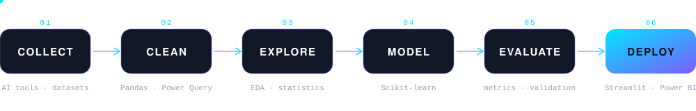
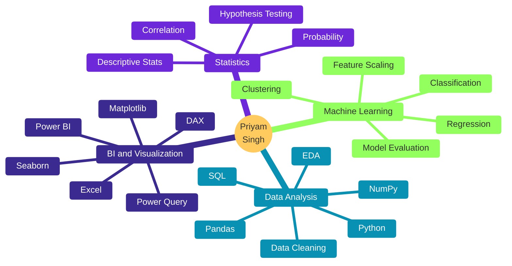
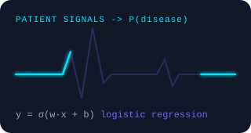
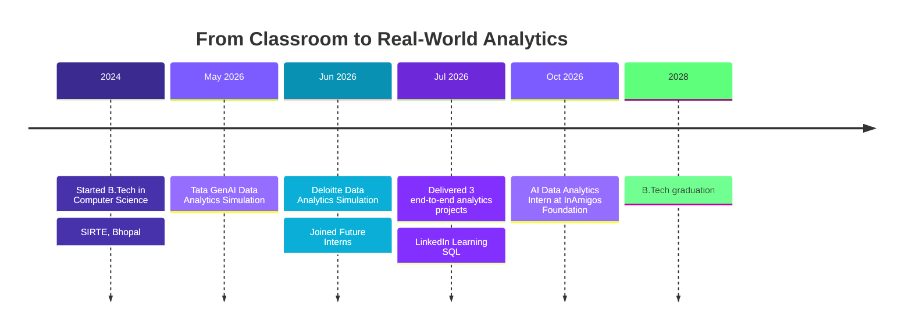

<!--
  PALETTE  ·  Violet #7C5CFF  ·  Cyan #00E5FF  ·  Indigo #3B2A8F  ·  Navy #0D1117
  Needs the /assets folder (header.svg, kpi.svg, pipeline.svg, divider.svg, project-*.svg) in this repo.
-->

<div align="center">



<a href="https://git.io/typing-svg">
  
</a>

<br/>


<br/><br/>

<a href="mailto:priyamsingh0017@gmail.com"></a>
<a href="https://www.linkedin.com/in/YOUR-LINKEDIN-ID"></a>
<a href="https://YOUR-PORTFOLIO-LINK"></a>


<br/><br/>



</div>

<br/>

<div align="center">

<br/>

</div>

```python
In [1]: import pandas as pd

In [2]: me = pd.Series({
   ...:     "name":      "Priyam Singh",
   ...:     "role":      "Data Analyst | Machine Learning",
   ...:     "education": "B.Tech CSE · SIRTE, Bhopal (2024-2028)",
   ...:     "location":  "Bhopal, Madhya Pradesh, India",
   ...:     "stack":     "Python · SQL · Power BI · Streamlit · Scikit-learn",
   ...:     "focus":     "Analytics · Business Intelligence · ML",
   ...:     "status":    "Open to internships & collaborations",
   ...: })

In [3]: me
Out[3]:
name                                          Priyam Singh
role                      Data Analyst | Machine Learning
education          B.Tech CSE · SIRTE, Bhopal (2024-2028)
location                    Bhopal, Madhya Pradesh, India
stack     Python · SQL · Power BI · Streamlit · Scikit-learn
focus              Analytics · Business Intelligence · ML
status              Open to internships & collaborations
dtype: object
```

<br/>

<div align="center">

<br/>

</div>

<table align="center">
<tr>
<td align="center" width="33%" valign="top">
<h3>🔍 ANALYZE</h3>
<sub>Clean messy datasets, run EDA and statistical tests, and uncover the story hidden in the numbers.</sub>
<br/><br/>


</td>
<td align="center" width="33%" valign="top">
<h3>📊 VISUALIZE</h3>
<sub>Build interactive dashboards and reports that turn KPIs into decisions people can act on.</sub>
<br/><br/>


</td>
<td align="center" width="33%" valign="top">
<h3>🤖 PREDICT</h3>
<sub>Train and evaluate regression, classification and clustering models for practical business problems.</sub>
<br/><br/>


</td>
</tr>
</table>

<br/>

<div align="center">

<br/>

</div>

<div align="center">

</div>

<br/>

<div align="center">

<br/>

</div>

<div align="center">


<br/>


<br/>


</div>

<br/>



<br/>

<div align="center">

<br/>

</div>

<table align="center">
<tr>
<td width="33%" valign="top">



<h3 align="center">HEART DISEASE PREDICTION</h3>

**🎯 Problem**<br/>
<sub>Estimate heart disease likelihood from patient health data.</sub>

**⚙️ Approach**<br/>
<sub>Preprocessing + EDA, then Logistic Regression for binary classification with model evaluation.</sub>

**📦 Output**<br/>
<sub>A deployed ML web app anyone can try.</sub>

<p align="center">


</p>

<p align="center">
<a href="https://github.com/priyam-10/YOUR-REPO-NAME"></a>
<a href="https://YOUR-DEMO-LINK"></a>
</p>

</td>
<td width="33%" valign="top">



<h3 align="center">MARKETING FUNNEL &amp; LEAD CONVERSION</h3>

**🎯 Problem**<br/>
<sub>Find where leads drop off and why marketing underperforms.</sub>

**⚙️ Approach**<br/>
<sub>Cleaned marketing data, then analysed conversion rates and funnel drop-offs.</sub>

**📦 Output**<br/>
<sub>An interactive Streamlit report with actionable improvement opportunities.</sub>

<p align="center">


</p>

<p align="center">
<a href="https://github.com/priyam-10/YOUR-REPO-NAME"></a>
<a href="https://YOUR-DEMO-LINK"></a>
</p>

</td>
<td width="33%" valign="top">



<h3 align="center">CUSTOMER RETENTION &amp; CHURN DASHBOARD</h3>

**🎯 Problem**<br/>
<sub>Understand why customers leave and who is at risk.</sub>

**⚙️ Approach**<br/>
<sub>Segmented customers by tenure and subscription pattern using Power Query and DAX.</sub>

**📦 Output**<br/>
<sub>An interactive Power BI dashboard tracking churn, retention and KPIs.</sub>

<p align="center">


</p>

<p align="center">
<a href="https://github.com/priyam-10/YOUR-REPO-NAME"></a>
<a href="https://YOUR-DEMO-LINK"></a>
</p>

</td>
</tr>
</table>

<p align="center">
<a href="https://github.com/priyam-10?tab=repositories"></a>
</p>

<br/>

<div align="center">

<br/>

</div>



<table align="center">
<tr>
<td width="50%" valign="top">

**💼 EXPERIENCE**

🟣 **Data Science & Analytics Intern**<br/>
<sub>Future Interns · Jun – Jul 2026</sub><br/>
<sub>3 end-to-end projects: sales performance, customer churn and marketing funnel conversion.</sub>

🟣 **AI Data Analytics Intern**<br/>
<sub>InAmigos Foundation · Oct 2026</sub><br/>
<sub>Research and data analysis supporting NGO outreach and engagement.</sub>

</td>
<td width="50%" valign="top">

**🏅 CERTIFICATIONS**

🔵 **GenAI Powered Data Analytics**<br/>
<sub>Tata · Forage</sub>

🔵 **Data Analytics Job Simulation**<br/>
<sub>Deloitte · Forage</sub>

🔵 **Learning SQL Programming**<br/>
<sub>LinkedIn Learning</sub>

🔵 **Data Analytics**<br/>
<sub>Unstop</sub>

</td>
</tr>
</table>

<br/>

<div align="center">

<br/>

</div>

<div align="center">


</div>

<br/>

<div align="center">


<a href="https://git.io/typing-svg">
  
</a>

<br/>

<a href="mailto:priyamsingh0017@gmail.com"></a>
<a href="https://www.linkedin.com/in/YOUR-LINKEDIN-ID"></a>

<br/><br/>

<i>"Without data, you're just another person with an opinion."</i>

</div>
